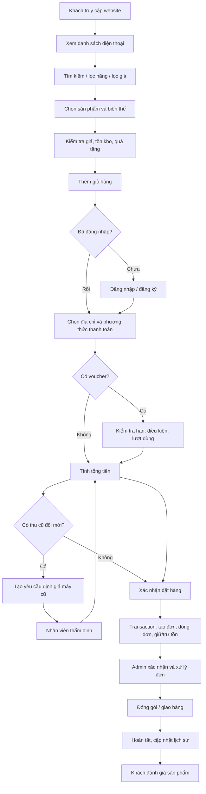

# BÁO CÁO ĐỒ ÁN: WEBSITE BÁN ĐIỆN THOẠI THEGIOIDIENTHOAI

## 1. Tổng quan và xác định yêu cầu

### 1.1. Mục tiêu
Xây dựng website bán điện thoại di động giúp khách hàng tra cứu, tìm kiếm, lọc, so sánh sản phẩm, chọn phiên bản bộ nhớ/màu sắc, nhận ưu đãi, quà tặng, đăng ký thu cũ đổi mới, đặt hàng và theo dõi đơn. Quản trị viên quản lý sản phẩm, tồn kho, khuyến mãi, voucher, quà tặng và đơn hàng.

### 1.2. Phạm vi
Trong phạm vi: điện thoại di động, thương hiệu, danh mục, biến thể SKU, tồn kho, tài khoản/role, địa chỉ, giỏ hàng, đơn hàng, voucher, khuyến mãi, quà tặng, thu cũ đổi mới, đánh giá và lịch sử trạng thái. Không bao gồm laptop, tablet, phụ kiện bán độc lập, kế toán tổng hợp hoặc tích hợp vận chuyển thực tế.

### 1.3. Tác nhân
- Khách hàng: đăng ký/đăng nhập, xem/tìm/lọc sản phẩm, chọn biến thể, so sánh, thêm giỏ, áp dụng voucher, chọn quà, yêu cầu thu cũ, đặt và theo dõi đơn, đánh giá.
- Quản trị viên: quản lý tài khoản và vai trò, thương hiệu, danh mục, sản phẩm/biến thể, giá, hình ảnh, tồn kho, chương trình khuyến mãi, voucher, quà, đơn hàng, đánh giá.
- Nhân viên bán hàng/kho/chăm sóc: xử lý đơn, xác minh trade-in, cập nhật tồn kho, hỗ trợ khách hàng theo quyền được cấp.

### 1.4. Yêu cầu phi chức năng
- Bảo mật: lưu mật khẩu dạng hash bằng thuật toán phù hợp; phân quyền server-side; chống SQL injection; xác thực dữ liệu đầu vào.
- Hiệu năng: phân trang danh sách, chỉ mục trên SKU, tên, thương hiệu và trạng thái đơn.
- Toàn vẹn: dùng FK, CHECK, UNIQUE và transaction khi tạo đơn/giảm tồn.
- Dễ dùng: responsive, tương thích màn hình di động, thông báo lỗi dễ hiểu.
- Bảo trì: phân lớp giao diện, nghiệp vụ, truy cập dữ liệu; ghi nhật ký thay đổi quan trọng.

## 2. Thiết kế cơ sở dữ liệu và chuẩn hóa

### 2.1. Danh sách thực thể
| Thực thể | PK | Vai trò |
|---|---|---|
| Users | UserID | Tài khoản khách hàng/nhân viên |
| Roles | RoleID | Danh sách vai trò |
| UserRoles | (UserID, RoleID) | Bảng nối người dùng-vai trò |
| Addresses | AddressID | Địa chỉ nhận hàng |
| Brands | BrandID | Thương hiệu |
| Categories | CategoryID | Danh mục điện thoại |
| Products | ProductID | Thông tin dòng điện thoại |
| ProductVariants | VariantID | SKU theo RAM/ROM/màu và giá |
| ProductImages | ImageID | Hình ảnh sản phẩm |
| Inventory | VariantID | Số lượng tồn theo SKU |
| InventoryTransactions | TransactionID | Lịch sử tăng/giảm kho |
| Vouchers | VoucherID | Mã giảm giá |
| VoucherUsages | VoucherUsageID | Lịch sử sử dụng voucher |
| VoucherProducts | (VoucherID, ProductID) | Bảng nối voucher-sản phẩm |
| Promotions | PromotionID | Chương trình khuyến mãi |
| PromotionVouchers | (PromotionID, VoucherID) | Bảng nối khuyến mãi-voucher |
| PromotionProducts | (PromotionID, ProductID) | Bảng nối khuyến mãi-sản phẩm |
| Gifts | GiftID | Quà tặng |
| ProductGifts | (ProductID, GiftID) | Bảng nối sản phẩm-quà |
| Carts | CartID | Giỏ hàng của tài khoản |
| CartItems | CartItemID | Các SKU trong giỏ |
| Orders | OrderID | Đơn hàng và tổng tiền |
| OrderItems | OrderItemID | Dòng sản phẩm trong đơn |
| OrderVoucherUses | (OrderID, VoucherID) | Voucher đã áp dụng vào đơn |
| OrderGiftItems | OrderGiftItemID | Quà tặng trong đơn |
| TradeInRequests | TradeInID | Yêu cầu định giá máy cũ |
| OrderTradeIns | (OrderID, TradeInID) | Bảng nối đơn và yêu cầu thu cũ |
| OrderStatusHistory | HistoryID | Lịch sử trạng thái đơn |
| Reviews | ReviewID | Đánh giá sản phẩm |

### 2.2. Quan hệ chính
- 1–N: Brand–Products, Category–Products, Product–Variants, User–Addresses, User–Orders, Order–OrderItems, Product–Reviews.
- 1–1: ProductVariant–Inventory (mỗi SKU có một bản ghi tồn kho hiện hành).
- N–N: Users–Roles, Promotions–Products, Promotions–Vouchers, Vouchers–Products, Products–Gifts, Orders–Vouchers, Orders–TradeInRequests. Mỗi quan hệ N–N được tách thành bảng nối.
- OrderItems lưu snapshot tên/SKU/đơn giá tại thời điểm mua để lịch sử không đổi khi tên hoặc giá sản phẩm được sửa.

### 2.3. Chuẩn hóa
- 1NF: mỗi ô chứa một giá trị nguyên tử; không lưu danh sách màu hoặc dung lượng trong một cột; mỗi sản phẩm có nhiều dòng ProductVariants.
- 2NF: các thuộc tính không khóa phụ thuộc đầy đủ vào khóa chính. Với bảng nối có khóa ghép như UserRoles, VoucherProducts, PromotionProducts, thuộc tính (nếu có) phải phụ thuộc vào toàn bộ khóa ghép.
- 3NF: không lưu tên thương hiệu lặp lại trong Products; Products chỉ lưu BrandID. Tên thương hiệu nằm trong Brands. Thông tin voucher, quà và chương trình được tách riêng để tránh phụ thuộc bắc cầu.
- Một số snapshot trong OrderItems/OrderGiftItems là ngoại lệ có chủ đích để bảo toàn lịch sử giao dịch.

### 2.4. Ràng buộc
- Email, SKU, mã voucher và mã đơn hàng là UNIQUE.
- Giá không âm; SalePrice không vượt ListPrice trong thiết kế mẫu.
- Số lượng tồn không âm; số lượng mua phải lớn hơn 0.
- Rating trong khoảng 1–5; DiscountType chỉ nhận AMOUNT/PERCENT.
- Mọi quan hệ quan trọng có FK. Tạo đơn và trừ tồn kho phải chạy trong transaction để tránh bán vượt tồn.

## 3. ERD và Database Diagram
Sơ đồ Mermaid nằm trong tệp `erd.mmd`. Dán nội dung vào trình xem Mermaid để dựng ERD. Để dựng Database Diagram trong SSMS:
1. Kết nối SQL Server và chạy `database.sql`.
2. Mở database `TheGioiDienThoai`.
3. Mở Database Diagrams → New Database Diagram.
4. Chọn các bảng cần hiển thị, Add, sắp xếp theo nhóm tài khoản, sản phẩm, khuyến mãi, giỏ hàng/đơn hàng.
5. Lưu sơ đồ; các đường liên kết được tạo từ FK đã khai báo.
6. Nếu SSMS yêu cầu cài hỗ trợ diagram, chấp nhận tạo các đối tượng hỗ trợ theo hướng dẫn của SSMS.

## 4. Triển khai SQL Server
Tệp `database.sql` chứa lệnh tạo database, bảng, PK/FK, UNIQUE, CHECK, DEFAULT và dữ liệu mẫu. Dữ liệu trong các bảng chính được tạo với 5 bản ghi mẫu nhằm kiểm thử quan hệ. Mật khẩu trong dữ liệu mẫu chỉ là chuỗi placeholder `DEMO_HASH_CHANGE_ME`, không dùng cho hệ thống thật; ứng dụng thật phải tạo hash mật khẩu bằng backend.

Cách chạy:
1. Mở SQL Server Management Studio.
2. Kết nối instance SQL Server.
3. Mở `database.sql`, chọn Execute.
4. Kiểm tra database và chạy truy vấn danh sách sản phẩm ở cuối script.
5. Dữ liệu giá/tên/hình ảnh là dữ liệu demo, cần thay bằng dữ liệu được cấp phép trước khi triển khai thực tế.

## 5. Luồng nghiệp vụ tổng thể

### 5.1. Sự kiện/chức năng
- `register`: kiểm tra email/số điện thoại, hash mật khẩu, tạo Users và gán Role Customer.
- `login`: xác thực thông tin; phát session/cookie an toàn; kiểm tra trạng thái tài khoản.
- `searchProducts`: tìm theo tên, hãng, SKU; phân trang kết quả.
- `filterProducts`: lọc hãng, giá, dung lượng, RAM, màu và tình trạng còn hàng.
- `selectVariant`: lấy giá và tồn kho theo VariantID.
- `addToCart`: kiểm tra số lượng hợp lệ và cập nhật CartItems.
- `applyVoucher`: kiểm tra hiệu lực, giá trị đơn tối thiểu, giới hạn lượt và sản phẩm áp dụng.
- `tradeInEstimate`: ghi nhận hãng/model/tình trạng; nhân viên cập nhật giá trị cuối.
- `checkout`: xác nhận địa chỉ, phương thức thanh toán, quà và giảm giá.
- `placeOrder`: dùng transaction kiểm tra tồn lần cuối, tạo Orders/OrderItems, ghi voucher/quà/thu cũ và cập nhật kho.
- `updateOrderStatus`: chỉ role có quyền được cập nhật trạng thái; ghi OrderStatusHistory.
- `reviewProduct`: kiểm tra rating 1–5 và có thể yêu cầu đơn đã hoàn tất trước khi đánh giá.

### 5.2. Quy tắc nghiệp vụ quan trọng
1. Không tin giá gửi từ trình duyệt; backend phải đọc lại giá trong database.
2. Tính lại tổng tiền ở máy chủ, không lấy tổng tiền do client gửi.
3. Trừ kho và tạo đơn trong cùng transaction; rollback nếu bất kỳ bước nào lỗi.
4. Không áp dụng voucher hết hạn, vượt lượt hoặc không đạt điều kiện.
5. Giá thu cũ là ước tính cho đến khi nhân viên kiểm tra máy thực tế.
6. Lưu lịch sử trạng thái đơn để truy vết.
7. Phân quyền ở backend, không chỉ ẩn nút Admin ở giao diện.

## 6. Thiết kế giao diện HTML/CSS
Tệp `index.html` là trang demo chạy độc lập, có:
- Header vàng, tìm kiếm, đăng nhập demo, voucher, giỏ hàng và khu vực.
- Bộ lọc nhanh theo thương hiệu, lọc giá, sắp xếp.
- Banner thu cũ đổi mới và khuyến mãi.
- Lưới thẻ điện thoại gồm hình minh họa, tên, lựa chọn bộ nhớ, giá bán, giá cũ, phần trăm giảm, quà tặng, đánh giá, so sánh và thêm giỏ.
- Modal đăng nhập/đăng ký và modal yêu cầu thu cũ.
- Responsive cho desktop và điện thoại.

### 6.1. Chạy giao diện
Mở `index.html` trực tiếp bằng Chrome/Edge. Kết nối mạng có thể cần thiết để tải hình ảnh placeholder. Các tương tác trên giao diện là demo frontend, chưa lưu dữ liệu vào SQL Server và chưa thực hiện xác thực/thanh toán thật.

### 6.2. Kiến trúc đề xuất cho phiên bản thực tế
- Frontend: HTML/CSS/JavaScript hoặc React.
- Backend: ASP.NET Core Web API, Node.js/Express hoặc công nghệ được môn học yêu cầu.
- Database: SQL Server.
- Các lớp: Presentation → API/Controller → Service/Business Logic → Repository/Data Access → SQL Server.
- Các API gợi ý: `GET /api/products`, `GET /api/products/{id}`, `POST /api/auth/register`, `POST /api/auth/login`, `POST /api/cart/items`, `POST /api/trade-ins`, `POST /api/orders`, `GET /api/orders/{id}`, `PATCH /api/admin/orders/{id}/status`.

## 7. Kiểm thử
| Mã | Tình huống | Kết quả mong đợi |
|---|---|---|
| TC01 | Tìm kiếm theo tên máy | Chỉ hiện sản phẩm phù hợp |
| TC02 | Lọc theo Samsung | Chỉ hiện Samsung |
| TC03 | Chọn dung lượng khác | Biến thể được cập nhật |
| TC04 | Thêm sản phẩm vào giỏ | Bộ đếm giỏ tăng |
| TC05 | Tìm từ khóa không tồn tại | Hiện thông báo không tìm thấy |
| TC06 | Giá bán âm | Database từ chối do CHECK |
| TC07 | SKU trùng | Database từ chối do UNIQUE |
| TC08 | Tạo dòng đơn với VariantID không tồn tại | Database từ chối do FK |
| TC09 | Voucher hết hạn | Backend từ chối áp dụng |
| TC10 | Tồn kho không đủ khi checkout | Không tạo đơn thành công; rollback |
| TC11 | Người dùng thường gọi API admin | Backend trả 403/không cho phép |
| TC12 | Trade-in chưa thẩm định | Chỉ là yêu cầu chờ, chưa khấu trừ giá trị cuối |

## 8. Kết luận và hướng phát triển
Đồ án mô hình hóa các nghiệp vụ cốt lõi của cửa hàng điện thoại trực tuyến, có phân tách sản phẩm với biến thể, quản lý tài khoản/phân quyền, tồn kho, đơn hàng, voucher, quà tặng và thu cũ đổi mới. Giao diện hiện tại là prototype để minh họa trải nghiệm; để thành hệ thống vận hành cần xây dựng backend, xác thực an toàn, thanh toán, tích hợp vận chuyển, quản lý ảnh, kiểm thử bảo mật và triển khai máy chủ.

**Lưu ý:** giá, tên mẫu máy, số lượng bán và hình ảnh trong bản demo chỉ nhằm minh họa giao diện, không phải dữ liệu giá bán thực tế hoặc xác nhận sản phẩm đang có hàng.
